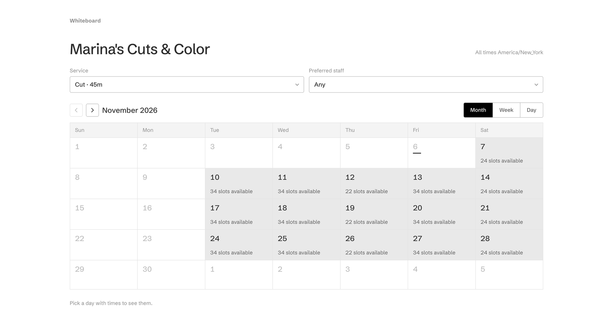
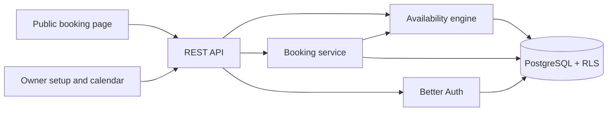
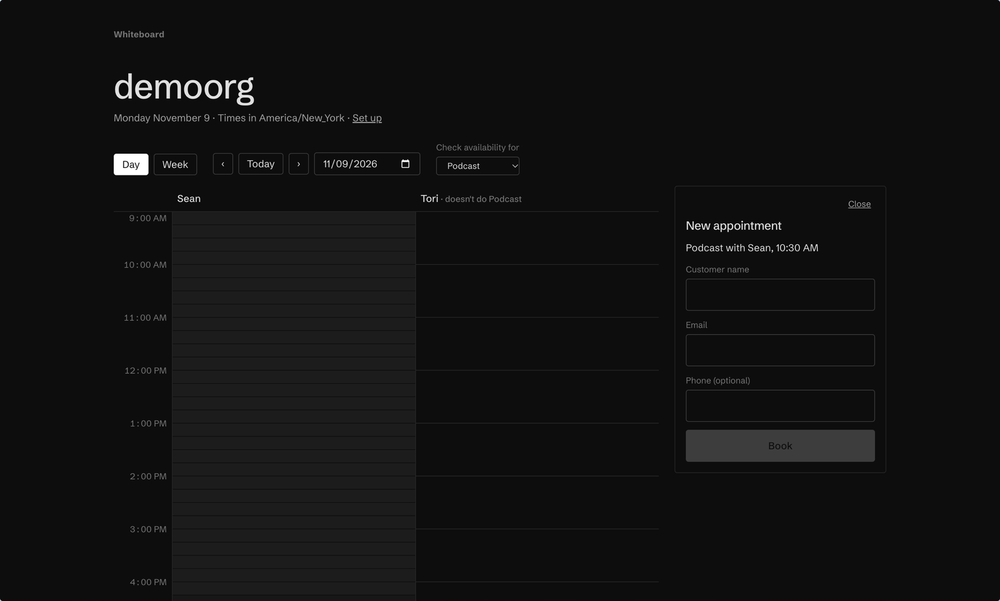

<div align="center">

# Whiteboard

**Multi-tenant booking software for service-based organizations.**

Computed availability across staff and room constraints · timezone-correct through DST · race-free reservation

[](LICENSE)
[](https://www.typescriptlang.org/)
[](https://nodejs.org/)
[](https://www.postgresql.org/)

[Live demo](https://whiteboardhq.app) · [API docs](docs/api.md) · [Design notes](docs/)

</div>

---



## Why this exists

A salon in Austria took my booking by writing my name and a time on a whiteboard on the wall.

**For the shop, that whiteboard is close to perfect.** No cost, no training, no login, no subscription, and it never goes down. The entire day is legible at a glance and a booking takes three seconds. Most scheduling software is a downgrade for the people who actually work there — more clicks, more fields, more screens between them and the answer they already had on the wall.

**For me as the customer, it was the opposite.** I had to be standing in the room to book anything. I couldn't see which times were open without asking someone to read the board for me. I couldn't book at 11pm from my hotel, which is when I actually thought about it. No confirmation to check later, no reminder the day before, and by the following week the board had been wiped — no record I'd ever been there.

Those two experiences pull against each other, and most booking products resolve it entirely in the customer's favor while handing the shop a second job. This one tries to keep what the whiteboard does well — the whole day visible at once, a booking in seconds, nothing to learn — and add the part it can't do: a page anyone can open at midnight from another country.

## Engineering highlights

| | |
|---|---|
| **Computed availability** | Bookable times are derived per request by intersecting business hours, staff working hours, approved time off, existing appointments plus buffers, and room conflicts — never pre-generated as slot rows. |
| **Two resource pools** | An in-person service requires a qualified staff member *and* a free room for the full duration. Most booking tools model only one resource per booking. |
| **Deliberate time handling** | Working hours stored as local wall time plus zone ID; appointments in UTC. 2pm remains 2pm across a DST transition, and tenants in different regions do not share a constant offset. |
| **Race-free reservation** | Check-then-insert has a race window. Reservation is enforced by a Postgres exclusion constraint, so two concurrent requests for the same slot produce exactly one booking and one clean error. |
| **Structural tenant isolation** | Enforced below the query layer rather than by a `WHERE tenant_id = ?` a developer can forget, with a test proving cross-tenant reads fail. |
| **Least-privilege database roles** | Four application roles, none of them the owner, none bypassing RLS — one each for authenticated tenant queries, signup provisioning, anonymous public reads, and authentication. Each connects through its own pool and holds per-table grants for only what its code does. |
| **Explainable gaps** | The owner calendar says why a time isn't bookable — who is busy and with what, who isn't working, which room is taken — straight from the engine's own reasons. |

Detailed write-ups live in [`docs/`](docs/).

## Architecture



One Express process serves the API and the built React app. Each path into the
database connects as its own role — public, sign-up, owner, auth — so row-level
security and per-table grants decide what each can touch. The availability
engine is a pure function: it takes hours, time off, appointments and resources
as arguments and returns bookable times plus the reason for every gap, which is
what lets the owner calendar explain itself. Routes are listed in
[`docs/api.md`](docs/api.md).



## Tech stack

| Layer | Choice |
|---|---|
| Backend | Node 26, TypeScript, Express |
| Database | PostgreSQL 18, `node-pg-migrate`, `pg` |
| Auth | Better Auth (organization plugin), with its own database role |
| Frontend | React 19, TypeScript, Vite, CSS Modules, Temporal for time zones |
| Testing | Vitest, Supertest, dedicated test database |
| Infrastructure | AWS EC2, Docker Compose, Caddy (automatic TLS), GitHub Actions (CI + deploy via SSM), SSM Parameter Store |

## Getting started

**Prerequisites:** Node 26+, Docker

```bash
git clone https://github.com/itsseanez/whiteboard.git
cd whiteboard
cp .env.example .env
```

Open the root `.env` and set:
- `POSTGRES_PASSWORD` — password for the Postgres superuser Docker creates on first boot.
- `DB_PORT` — only change this if `5432` is already in use locally.

```bash
docker compose up -d          # PostgreSQL on :5432

cd backend
cp .env.example .env
```

Open `backend/.env` and set real values:

- `DATABASE_URL` — must use the same password you set for `POSTGRES_PASSWORD` above.
- `WHITEBOARD_APP_PASSWORD`, `WHITEBOARD_SIGNUP_PASSWORD`, `WHITEBOARD_PUBLIC_PASSWORD`, `WHITEBOARD_AUTH_PASSWORD` — used to create dedicated, permission-scoped Postgres roles during migration.
- `APP_DATABASE_URL`, `SIGNUP_DATABASE_URL`, `PUBLIC_DATABASE_URL`, `AUTH_DATABASE_URL` — each must embed the matching password above. The migration and the connection string are not linked automatically; a mismatch produces a successful migration followed by an authentication failure.
- `BETTER_AUTH_SECRET` — generate a fresh random value (e.g. `openssl rand -base64 32`). Never reuse an example value or share this between environments; it signs session tokens.
- `BETTER_AUTH_URL` — `http://localhost:3000` locally. Without it, the request origin is derived from incoming headers.
- `PORT` — defaults to 3000.

```bash
npm install
npm run migrate up            # apply migrations, including creating app-specific DB roles
npm run seed                  # create demo users + organizations, link to seeded tenants
npm run dev                   # API on :3000

cd ../frontend
npm install
npm run dev                   # UI on :5173
```

Seed data creates two demo tenants in different timezones, each with a linked demo account — printed to the console when the seed script runs.

### Running the tests

The backend tests run against a separate `whiteboard_test` database, through
the same four roles, so they exercise row-level security for real. Docker
creates that database on first boot (`db-init/create-test-db.sh`).

```bash
cd backend
cp .env.test.example .env.test   # every URL points at whiteboard_test; use the same role passwords as .env
# in .env, set TEST_DATABASE_URL to the owner URL for whiteboard_test
npm run migrate:test up
npm run seed:test
npm test

cd ../frontend && npm test
```

After pulling new migrations, run both `npm run migrate up` and
`npm run migrate:test up`; the tests fail on a missing column otherwise. CI
builds a fresh test database on every push and checks that new migrations run
both on it and on top of the ones already deployed.

### Scripts

| Script | Does |
|---|---|
| `npm run dev` | `tsx watch` against `src/server.ts` — transpiles without typechecking |
| `npm run build` | `tsc` — compiles `src/` to `dist/` |
| `npm start` | Runs the compiled `dist/server.js` |
| `npm run typecheck` | `tsc -p tsconfig.check.json` — checks `src`, `tests`, `scripts`, and config, emitting nothing |
| `npm test` | Vitest against `whiteboard_test` |
| `npm run migrate up` | Migrations against `DATABASE_URL` |
| `npm run migrate:test up` | Migrations against `TEST_DATABASE_URL` |
| `npm run seed` | Demo users and organizations, linked to the seeded tenants |
| `npm run seed:test` | The same, against the test database in `.env.test` |

Because `dev` does not typecheck, run `npm run typecheck` before pushing. CI runs it too.

## Deployment

A single EC2 instance running Docker Compose: Postgres, the API, a one-shot migration service, and Caddy for automatic TLS. Images are built in GitHub Actions, tagged by commit SHA, and pushed to GHCR; the instance pulls them. Deploys are triggered via SSM `send-command` authenticated by GitHub OIDC — no SSH, no stored credentials, port 22 closed. Production secrets live in SSM Parameter Store and are fetched by the instance profile at deploy time.

Rationale for each of these is in [`DECISIONS.md`](DECISIONS.md); the database role model is in [`docs/database-roles.md`](docs/database-roles.md).

## Status

In active development since August 2026. The full definition of done in [`DECISIONS.md`](DECISIONS.md#definition-of-done) runs on production.

- [x] Tenancy, authentication, roles, core model, deployed
- [x] Availability engine
- [x] Booking flow, public page, concurrency
- [x] Self-serve sign-up and owner setup: staff, hours, services, resources
- [x] Owner calendar: day and week views, why a time isn't bookable, book, move and cancel
- [x] Customers cancel and reschedule by link
- [x] Demo tenants
- [ ] Email notifications, audit trail, webhooks
- [ ] Staff calendars, API docs

## License

[MIT](LICENSE)
